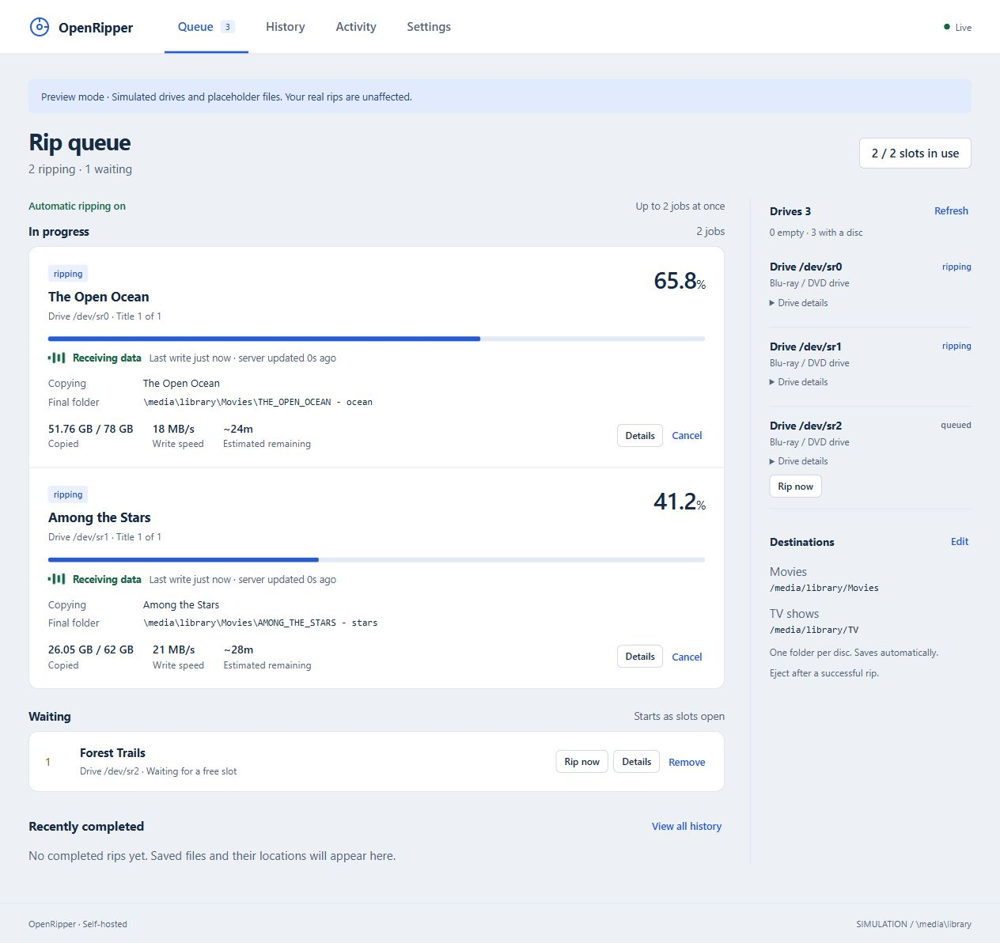
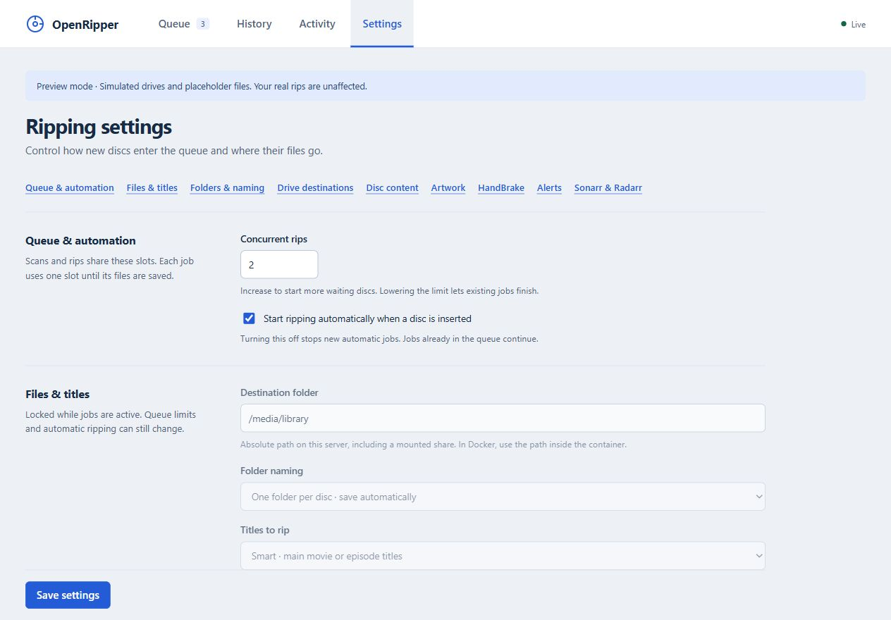
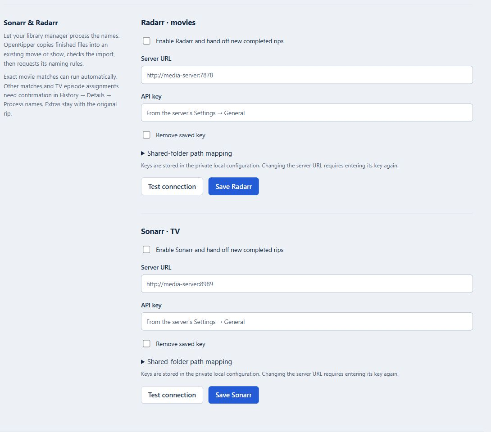

# OpenRipper screenshots

Captured from the app using simulated drives, fictional titles and generic paths.

## Rip queue

Active rips, write activity, final destinations and waiting discs in one view.

## Settings

Control automatic ripping, concurrent jobs, storage and title selection.

## Sonarr and Radarr

Connect existing libraries for imports and naming. API keys are left blank here.

[Back to README](../README.md)
